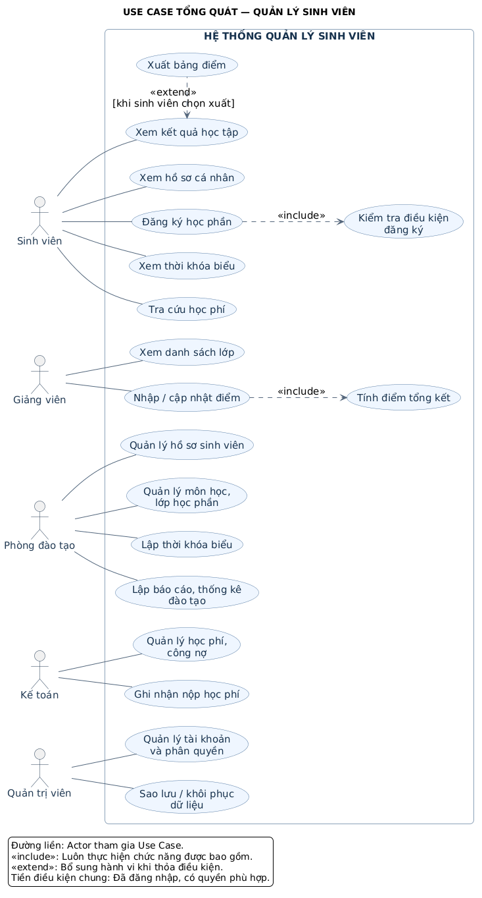

# Biểu đồ Use Case tổng quát — Hệ thống Quản lý Sinh viên

Đây là mô hình đề xuất cho một trường quản lý hồ sơ, học phần, lịch học, kết quả học tập và học phí. Các quy tắc cụ thể có thể điều chỉnh theo yêu cầu thực tế.

## 1. Biểu đồ

- `use-case-quan-ly-sinh-vien.puml`: mã nguồn PlantUML có thể chỉnh sửa.
- `use-case-quan-ly-sinh-vien.svg`: hình vector có thể phóng to.
- `use-case-quan-ly-sinh-vien.png`: hình để chèn vào báo cáo.

## 2. Actor và Use Case

Actor biểu thị vai trò tương tác với hệ thống; một người có thể đảm nhiệm nhiều vai trò. Phòng đào tạo và Kế toán là vai trò của cán bộ sử dụng phần mềm.

| Actor | Use Case tham gia |
|---|---|
| Sinh viên | Xem hồ sơ cá nhân; đăng ký học phần; xem thời khóa biểu; xem kết quả học tập; tra cứu học phí. Có thể chọn xuất bảng điểm khi xem kết quả. |
| Giảng viên | Xem danh sách lớp được phân công; nhập/cập nhật điểm các lớp được phân công. |
| Phòng đào tạo | Quản lý hồ sơ sinh viên; quản lý môn học, lớp học phần; lập thời khóa biểu; lập báo cáo, thống kê đào tạo. |
| Kế toán | Quản lý học phí, công nợ; ghi nhận nộp học phí. |
| Quản trị viên | Quản lý tài khoản và phân quyền; sao lưu/khôi phục dữ liệu. |

Ba Use Case hỗ trợ/mở rộng gồm: Kiểm tra điều kiện đăng ký, Tính điểm tổng kết và Xuất bảng điểm. Tổng cộng có 18 Use Case.

## 3. Mối quan hệ

### Association — liên kết

Đường liền nối Actor với Use Case thể hiện vai trò tham gia chức năng, không biểu thị thứ tự xử lý. Ví dụ: Sinh viên — Đăng ký học phần; Giảng viên — Nhập/cập nhật điểm.

### Include — bao gồm bắt buộc

- **Đăng ký học phần → Kiểm tra điều kiện đăng ký**: mỗi yêu cầu đăng ký đều phải được kiểm tra. Ví dụ: thời hạn đăng ký, học phần tiên quyết, sĩ số, trùng lịch và giới hạn tín chỉ. Yêu cầu không hợp lệ sẽ bị từ chối.
- **Nhập/cập nhật điểm → Tính điểm tổng kết**: mô hình giả định mỗi lần lưu điểm hợp lệ, hệ thống tính lại kết quả theo công thức của học phần. Khi chưa đủ điểm thành phần, kết quả có trạng thái chưa hoàn tất.

Mũi tên nét đứt `<<include>>` đi từ Use Case chính đến Use Case bắt buộc được gọi.

### Extend — mở rộng có điều kiện

- **Xuất bảng điểm → Xem kết quả học tập**: tại điểm mở rộng “kết quả đã hiển thị”, nếu sinh viên chọn xuất bảng điểm, hệ thống tạo tệp để tải về. Việc xem kết quả vẫn hoàn tất khi sinh viên không chọn xuất.

Mũi tên nét đứt `<<extend>>` đi từ Use Case mở rộng đến Use Case cơ sở.

Không sử dụng quan hệ khái quát hóa/kế thừa trong mô hình này vì chưa có yêu cầu về các vai trò hoặc Use Case chuyên biệt.

## 4. Phạm vi và giả định

- Các Actor nằm ngoài hình chữ nhật; các Use Case nằm trong ranh giới Hệ thống Quản lý Sinh viên.
- Đăng nhập và có quyền phù hợp là tiền điều kiện chung của các nghiệp vụ được vẽ. Sơ đồ tổng quát lược bỏ các chức năng xác thực riêng.
- Sinh viên chỉ truy cập dữ liệu cá nhân; giảng viên truy cập các lớp được phân công; cán bộ thao tác theo quyền được cấp.
- Kế toán ghi nhận các khoản đã nộp. Thanh toán trực tuyến và cổng thanh toán ngoài hệ thống chưa thuộc phạm vi đề xuất.
- Biểu đồ mô tả chức năng và vai trò, không mô tả quy trình hoặc thứ tự thực hiện.

## 5. Chỉnh sửa

Mở tệp `.puml` bằng trình soạn thảo hỗ trợ PlantUML hoặc dán nội dung vào trình biên tập PlantUML để xuất lại hình.

Tham khảo cú pháp: [PlantUML — Use case diagram](https://plantuml.com/use-case-diagram).
